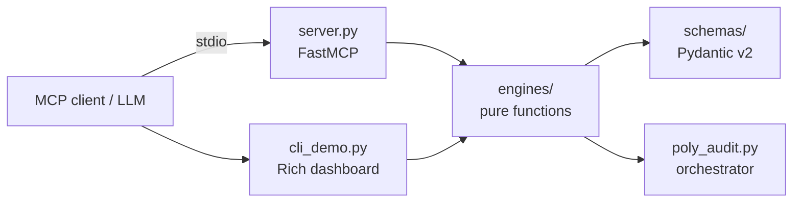

# clinical-mcp 🩺
> **LLMs are probabilistic token predictors; human physiology is a coupled mathematical system.** `clinical-mcp` decouples clinical reasoning from bedside arithmetic by exposing **14 deterministic, biologically bounded physiological engines** across 6 medical specialties via the Model Context Protocol (MCP 2.x).


Deterministic Model Context Protocol (MCP) server providing zero-hallucination physiological calculators with strict Pydantic v2 biological boundary guards.

---

## ⚡ Clinical Benchmark: Naive LLM vs. clinical-mcp

Asking generalist LLMs to calculate renal clearance, correct sodium for hyperglycemia, or evaluate wide-QRS QTc intervals leads to fatal arithmetic and boundary hallucinations.


[-brightgreen)](tests/)
[](pyproject.toml)
[](src/clinical_mcp/server.py)
[](LICENSE)

**Open Clinical AI Lab** — deterministic clinical physiology for AI agents. Every calculation runs
in pure Python; the model never does token arithmetic.

## Why

LLMs guess doses, anion gaps, and QTc corrections. `clinical-mcp` exposes 14 validated calculators
as MCP tools with fail-fast biological bounds, coupled physiological corrections, KDIGO/UNOS/Berlin
staging, and structured trap telemetry (`llm_trap_prevented`).

## Hexagonal architecture



`engines/` imports only `schemas/`; it has no MCP, Rich, or network dependency.

## Quickstart

```bash
uv sync
uv run pytest -v
uv run python -m clinical_mcp.cli_demo
uv run clinical-mcp
```

## Calculators and traps prevented

| # | Calculator | LLM trap prevented |
|---|------------|--------------------|
| 1 | CKD-EPI 2021 | Legacy 141 + race coefficient |
| 2 | Cockcroft-Gault | Total-body-weight dosing in obesity |
| 3 | AKI FENa/FEUrea | Diuretic-confounded FENa |
| 4 | Acid-base | Hypoalbuminemia-masked HAGMA |
| 5 | Osmolality | Missing osmolar gap / free water deficit |
| 6 | Corrected calcium | Falsely low total calcium |
| 7 | QTc (Bazett/Fridericia/Framingham) | Tachycardia and wide-QRS artifact |
| 8 | Hemodynamics | Normal SBP masking occult shock |
| 9 | MELD-Na | Missing UNOS floors/caps |
| 10 | MELD 3.0 | Creatinine cap 3.0 vs 4.0 |
| 11 | FIB-4 | ALT-only fibrosis guess |
| 12 | Oxygenation | Missing 47 mmHg water-vapor term |
| 13 | qSOFA/SIRS | Scoring SIRS from one parameter |
| 14 | Wells + age-adjusted D-dimer | Fixed 500 ng/mL in older adults |

## MCP configuration

Claude Desktop (`claude_desktop_config.json`):

```json
{
  "mcpServers": {
    "clinical-mcp": {
      "command": "uv",
      "args": ["--directory", "/absolute/path/to/clinical-mcp", "run", "clinical-mcp"]
    }
  }
}
```

Cursor / OpenCode (`mcp.json`):

```json
{
  "mcpServers": {
    "clinical-mcp": {
      "command": "uv",
      "args": ["run", "--directory", "/absolute/path/to/clinical-mcp", "clinical-mcp"]
    }
  }
}
```

## Safety

`clinical-mcp` is decision support, not a diagnosis or prescription. Every output includes staging
and `clinical_pearls_and_actions`; a clinician remains responsible for the final decision.
